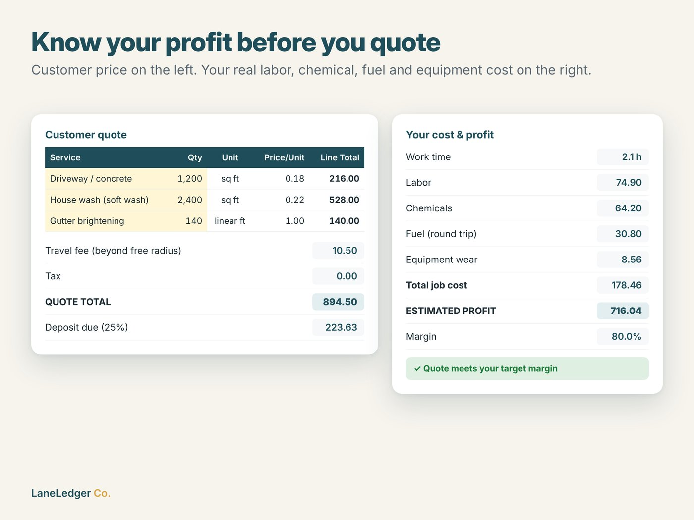
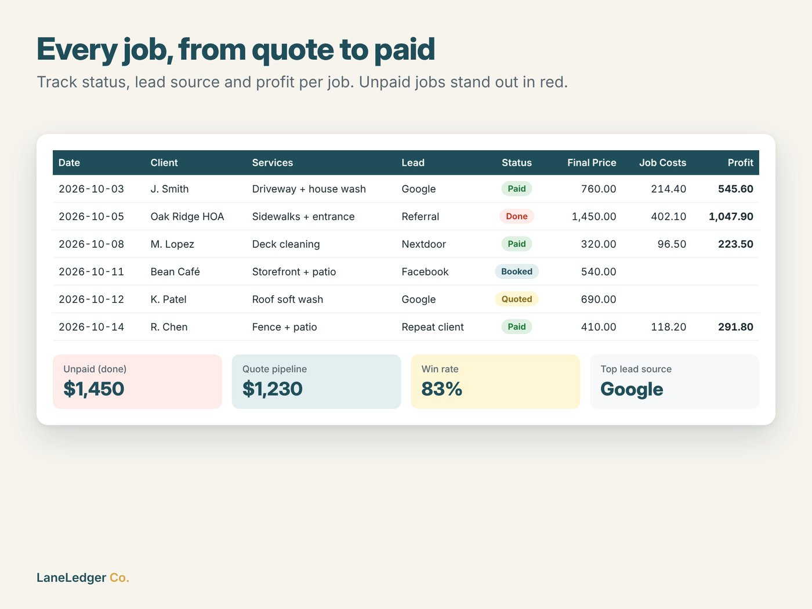
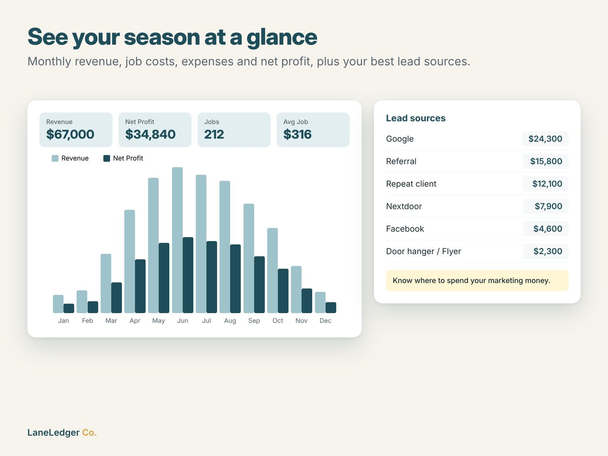
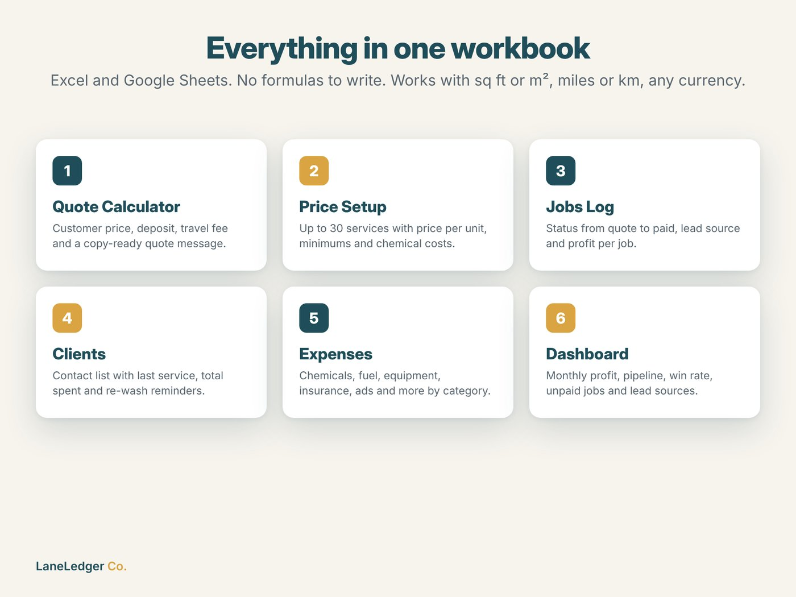

# Pressure Washing Business Toolkit

An 8-tab Excel / Google Sheets workbook for pressure washing and soft washing businesses: quote faster, price every job for real profit, and never forget a re-wash.

**[View on Etsy](https://www.etsy.com/listing/4602384022/pressure-washing-business-spreadsheet)** · **[Download the free demo](demo/Pressure_Washing_Quote_Calculator_FREE_DEMO.xlsx?raw=1)** · Part of [LaneLedger Co.](https://github.com/EkremHakanSevil/laneledger-spreadsheet-tools)

## Features

- **Quote Calculator** – services, quantities and distance in; customer price out, with minimum charges, travel fee beyond a free radius, discount, tax, deposit, and a copy-ready quote message
- **Internal cost & profit** – estimated work time from per-service production rates, labor, chemical, fuel and equipment cost, profit, margin, effective hourly rate, and a warning when a quote falls below the target margin
- **Price Setup** – up to 30 services with price per unit, minimum charge, chemical cost and production rate
- **Jobs Log** – pipeline from Quoted → Booked → Done → Paid / Lost, lead source and profit per job, unpaid work highlighted
- **Clients (CRM)** – jobs, total spent and last service pulled from the Jobs Log, plus automatic "Due now / Due soon" re-wash reminders
- **Expenses** – chemicals, fuel, equipment, insurance, marketing and more by category
- **Dashboard** – monthly revenue, job costs, expenses and net profit, quote win rate, unpaid jobs and revenue by lead source

| Quote & profit | Jobs pipeline | Re-wash reminders |
|---|---|---|
|  |  |  |

| Dashboard | What's included |
|---|---|
|  |  |

## 🎁 Free demo

[`Pressure_Washing_Quote_Calculator_FREE_DEMO.xlsx`](demo/Pressure_Washing_Quote_Calculator_FREE_DEMO.xlsx?raw=1) includes the full Quote Calculator with cost & profit analysis for up to 5 services. Open it in Excel or import it into Google Sheets (File → Import → Upload).

The [full version](https://www.etsy.com/listing/4602384022/pressure-washing-business-spreadsheet) adds 30 services, the Jobs Log, Clients CRM with re-wash reminders, Expenses and the Dashboard.

## How it was built

| Area | Details |
|---|---|
| Niche research | Keyword demand vs. competition analysis: high search interest for pressure washing, very few competing spreadsheet tools on Etsy |
| Generation | Python + `openpyxl`: the workbook is generated from code, with styling, dropdown validation, conditional formatting, a chart and ~3,700 formulas |
| Formulas | Excel-2007-compatible functions (`SUMIFS`, `COUNTIFS`, `INDEX/MATCH`, `MAXIFS`, `EDATE`) so it works in both Excel and Google Sheets |
| Testing | Headless LibreOffice recalculation (zero formula errors) plus hand-checked cases for quote totals, travel fees, work time, job cost and margin |
| Images | HTML/CSS templates rendered to 2000×1500 listing images with Playwright |

**AI-assisted:** Built in collaboration with Anthropic's Claude. I chose the niche, pricing and branding, reviewed and tested the product and ran the Etsy listing; Claude helped with research, code generation, design and copywriting. The Etsy listing discloses AI use as required by Etsy's Creativity Standards.

---
*Screenshots, documentation and a free demo only. The full workbook is sold on Etsy.*
